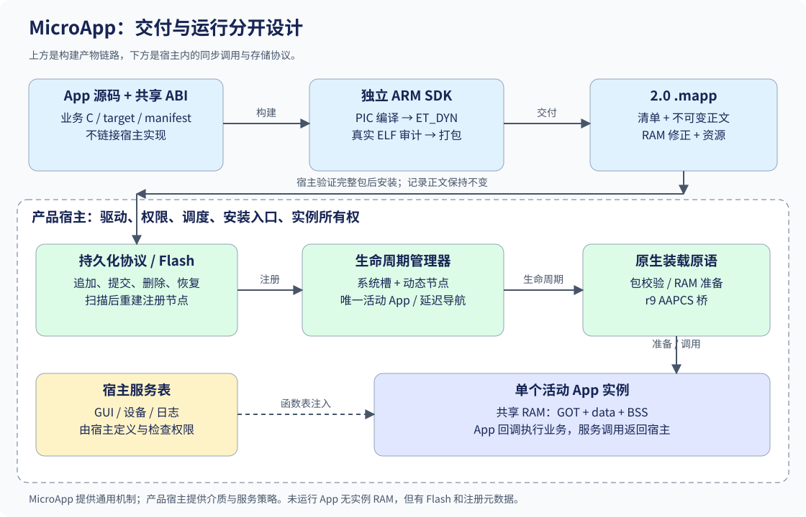
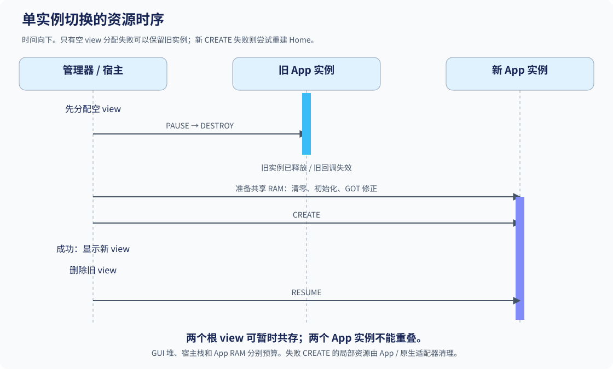

# MicroApp 教程：从软件架构理解 MCU 上的动态 App {#microapp_architecture_tutorial}

本文以 **MicroApp V0.0.2 实现**为基础，解释如何把一个普通 MCU 工程拆成“稳定宿主 + 可独立交付的 App”。包格式为 2.0，存储容器版本为 1，宿主 ABI 另行定义；三个版本服务于不同兼容边界。宿主可按仓库提交固定 V0.0.2 依赖，原 v0.0.1 标签保留。

读者需要了解 C 函数指针、结构体、Flash/RAM 和基本链接概念。对 ELF、GOT 或 PIC 不熟悉也可以继续阅读，首次出现时会说明它解决什么问题。本教程围绕实际源码建立架构认知；具体 GUI、Flash 驱动和板级配置由产品宿主提供。

## 学习目标

读完后，应能回答并定位以下问题：

1. 哪些能力应该进入 MicroApp，哪些应该留在产品宿主？
2. 一个 App 从源码到包、从安装到执行，经历了哪些转换？
3. 为什么安装多个 App 不意味着为每个 App 分配实例 RAM？
4. GOT/r9 怎样让同一份正文适应不同 Flash/RAM 地址？
5. 生命周期切换、延迟事件与存储提交各自维护什么不变量？
6. 移植宿主时，要实现哪些契约，怎样判断证据足够？

> 学习过程中遇到机制性问题，可以对照文末 Q&A。API 的参数、所有权和错误结果以公共头文件及生成的 Doxygen 文档为准。

## 知识学习

### 1. 从单体固件到稳定宿主

普通固件把时钟、驱动、RTOS、GUI 和业务页面一起编译。一个页面直接调用 LVGL 或 HAL 函数，链接器会把依赖解析为该次固件的地址。页面越依赖工程内部对象，就越难单独更新、迁移或交付。

MicroApp 把“可变化的业务代码”放入独立 App，把“长期稳定的设备与平台能力”保留在宿主。宿主就是承载 App 的主固件：它管理调度、显示、驱动、安装入口和权限，通过一个接口表把服务交给 App。

这里的动态，包含两个不同阶段：安装时增加持久化记录；运行时找到入口、准备实例 RAM 并调用 App。它不自动创建进程、任务或虚拟地址空间。当前 App 在宿主的调用上下文执行，不能把它理解成带内存隔离的桌面操作系统进程。



图中源码经过工具链产生不可变正文；另一条链路是宿主在运行时提供服务。App 不通过链接宿主的实现库来获得服务，而是在入口处接收函数表。产品可换成 LVGL 宿主、串口宿主或其他服务组合，独立核心不因此增加 GUI 依赖。

### 2. 按变化原因分层

分层的依据是“谁会因为什么原因改变”。芯片变化应主要影响驱动，GUI 变化应主要影响宿主 view/服务表，App 业务变化应主要影响 App，包格式变化才影响打包器与校验器。

| 层 | 负责什么 | 当前源码入口 | 不承担什么 |
|---|---|---|---|
| 生命周期管理器 | 注册、唯一活动 App、导航、view 时序 | `include/microapp/microapp.h`、`src/microapp.c` | Flash 安装、GUI 控件、调度线程 |
| 原生装载原语 | 包/正文校验、实例 RAM、r9 调用桥 | `microapp_native.h`、`microapp_native.c`、`microapp_arm_call.S` | 签名可信策略、资源 UI、槽选择 |
| 持久化协议 | 追加提交、更新/删除、枚举、整理恢复 | `microapp_store.h`、`microapp_store.c` | HAL、文件系统、自动锁、物理 Flash 时序 |
| ARM SDK | 编译链接、ELF 审计、打包与报告 | `cmake/`、`tools/microapp/` | 产品服务表、完整 libc、C++/TLS |
| 产品宿主 | 驱动回调、服务表、实例管理、安装入口、事件安全 | 产品自己的适配目录 | 重新实现通用包格式与 GOT 准备 |
| App | 业务状态、UI/算法、资源使用 | `examples/counter/` 或产品 App | 直接绑定宿主内部实现地址 |

这些层是可组合的库与工具，不是六个独立线程。仅使用生命周期管理器时不必启用原生执行或存储。`MicroApp::sdk` 是头文件接口目标，供独立 App 编译；`MicroApp::core` 提供宿主侧核心实现。链接静态库时，最终保留哪些对象还取决于宿主链接设置。

生命周期模块和原生模块之间也留有边界：管理器只看到生命周期函数指针和不透明 `user`；它不知道该 App 是固件内置代码、ARM 原生正文还是模拟器 DLL。宿主把具体执行方式封装在生命周期适配器中。

### 3. 三种对象：安装记录、注册描述符、运行实例

这三个对象的有效期不同，是理解多 App 的关键。

| 对象 | 存在哪 | 创建时机 | 结束时机 | 保存什么 |
|---|---|---|---|---|
| 安装记录 | 非易失 Flash | 包通过验证并提交 | 标记删除，后续整理回收 | 清单、正文位置、CRC、提交状态 |
| 注册描述符/节点 | 宿主 RAM | 启动扫描或安装后重新扫描 | 注销或管理器反初始化 | ID、显示信息、生命周期、宿主上下文 |
| 运行实例 | 共享 App RAM 与宿主运行状态 | 进入 App 的 CREATE | DESTROY | GOT、data、BSS、活动视图、回调有效性 |

因此“已安装但未进入”仍占 Flash 和少量注册 RAM，却不需要该 App 的 GOT/data/BSS 实例空间。只在进入时准备共享 RAM；退出后释放实例所有权。若安装十个 App 且只允许一个运行，实例 RAM 通常需要按其中最大需求规划，而不是把十个需求相加。除此之外，还必须预算宿主堆、注册元数据、GUI 对象、任务栈以及服务缓存。

动态注册节点采用侵入式链表：`microapp_registration_t` 中的 `next` 就是节点自身的一部分。核心不申请堆内存，宿主可以用静态数组、内存池或堆来提供节点。节点必须零初始化，并在注册期间一直有效。持久化记录不保存这个 `next` 指针，重启时重新扫描 Flash、重建 RAM 链表。

系统 App 保留八个静态注册槽；动态 App 不消耗这些槽。下面是接口关系示意，`app` 和 `port` 都由宿主持有：

```c
microapp_t manager = {0};
microapp_registration_t node = {0};

/* 宿主检查每次返回值；先注册 Home，再注册其他描述符。 */
microapp_init(&manager, &port, host);
microapp_register(&manager, &home_app);
microapp_register_dynamic(&manager, &node, &app);
```

这段展示所有权关系，不是一个完整产品宿主。`port` 的 view 回调和 `home_app/app` 的生命周期表必须有真实实现；局部临时变量不能在注册后离开作用域。成功注销动态 App 会清空节点字段，之后宿主才可以释放或复用节点。`microapp_unregister()` 只移除 RAM 注册信息，不能代替持久化卸载。

导航历史另有八项上限，与动态 App 数量无关。当前历史满后不再追加新条目；它不是会无限增长的浏览器历史。

### 4. 生命周期是资源所有权协议

CREATE、RESUME、PAUSE、DESTROY、TICK 不只是通知名称，它们划定资源何时可以建立、访问和释放。

| 回调 | 当前职责 | 资源约束 |
|---|---|---|
| CREATE | 在空 view 中建立一个实例 | 入口前准备好 App RAM；失败需自行清理部分资源 |
| RESUME | 激活已经成功创建的实例 | 核心成功路径已显示新 view |
| PAUSE | 停止当前活动业务 | 为销毁做准备，不能启动第二个实例 |
| DESTROY | 释放 App 所有资源，停止回调来源 | 后续不得再访问该实例；根 view 由宿主删除 |
| TICK | 处理宿主提供的经过时间 | 没有待提交导航时才执行；核心自身无时钟 |

当前切换先让宿主申请一个空 view。申请失败时旧 App 还活着，可以保持原界面。申请成功后，旧 App PAUSE/DESTROY，然后新 App CREATE；新 CREATE 之前旧实例 RAM 所有权已经释放。这一顺序使多个原生 App 能安全复用同一片 RAM。



成功路径随后显示新 view、删除旧 view、调用新 RESUME。宿主的 `show_view` 必须能成功，不能在这个阶段再返回显示失败。正常切换会暂时持有两个根 view，但不会同时存在两个成功存活的 App 实例，所以 GUI 堆与 App RAM 是不同的预算。

新 CREATE 失败时，旧 App 已经被销毁，不能继续使用它的运行状态。核心删除失败 view、清空导航历史并尝试重新创建首个注册 App，通常是 Home。即便 Home 恢复成功，原调用仍返回新 CREATE 的错误。Home 自己也失败时，核心可能保留空 view；宿主还应提供错误显示或后续恢复能力。

失败 CREATE 不会自动触发该失败实例的 DESTROY。它应自己释放局部资源；原生宿主适配器也必须清理已准备的 RAM、服务绑定和回调状态。立即启动已经活动的同一个 App 是成功的空操作，不会重置其状态；需要重建时应先退出再进入。

### 5. 延迟导航：避开事件栈内销毁

设想按钮回调正在读取一个控件，而回调里立即跳回 Home，原控件可能在回调尚未返回时被删除。即便没有多线程，也会产生重入与失效引用问题。

MicroApp 提供一个待处理导航位置 `pending`。事件回调可以调用 `microapp_request_home()` 等接口，只记录目标；宿主下一次调用 `microapp_tick()` 才提交切换。这不是任务队列或后台工作线程，而是宿主循环中的一个安全提交点。

```text
宿主收到按钮事件
  → 调用 App 回调
  → App 请求 Home，pending 指向 Home
  → App 回调返回，事件派发结束
  → 宿主调用 microapp_tick()
  → 提交 PAUSE/DESTROY/CREATE 等切换
```

当前只有一个 pending 位置，最后一次请求覆盖前一次；不要把它当作 FIFO。Back 在请求时就弹出历史，Home 在请求时清空历史。提交导航的那次 tick 不会再调用活动 App 的 TICK。`dispatching` 是同步重入保护，不是 RTOS 互斥锁；多个任务操作同一个管理器仍需宿主串行化。

对于 GUI 事件，不能假设 GUI 库会通过生命周期管理器的重入标志保护所有调用。产品应统一使用延迟导航，并在事件派发结束后提交。ISR 若要触发导航，应先通知宿主任务，不要直接从中断运行 GUI 或 App 生命周期。

### 6. 接口注入：服务归宿主，业务归 App

ABI 是两段已编译机器码之间的调用约定，涉及字段布局、函数参数、指针宽度、结构体对齐和浮点参数传递方式。仅仅 C 源码里类型名字相同，并不保证 ABI 相同。

App 导出统一入口：

```c
int32_t microapp_main(const void *host_api,
                     microapp_abi_context_t *context,
                     uint32_t reason, void *arg);
```

`host_api` 保持不透明，独立核心不解释 GUI、传感器或文件服务。App 和宿主共同使用一份产品接口头，把它转换为具体结构体。所有接口表以 `microapp_abi_header_t` 开头：`abi_major` 检查破坏性兼容，`abi_minor` 表示兼容扩展，`struct_size` 让 App 在访问后续字段之前判断它们是否存在。

counter 示例只约定日志服务：

```c
typedef struct {
    microapp_abi_header_t header;
    void (*log)(const char *message, uint32_t count);
} counter_host_api_t;
```

App 通过 `api->log(...)` 请求服务。服务函数实现和设备驱动留在宿主，App 没有链接它们的最终地址。宿主可以让 `log` 写串口，也可以写内存日志；App 只依赖约定的语义。若该服务会保留传入字符串，必须约定复制或有效期，否则 App 销毁后宿主还持有 App 指针会出错。

`context->permissions` 与 `host_user` 也是宿主定义的契约。权限位必须在各服务中实际检查；仅把位写进包或 context，不会产生内存隔离或阻止任意机器码访问硬件。正式签名和授权由宿主策略负责，CRC 不能证明 App 来自可信作者。

### 7. 从源码到安装包：为什么先审计 ELF

ELF 是工具链生成的可执行目标格式，里面除了代码，还有节、符号、架构属性和重定位。重定位记录说明“某个位置依赖哪个符号/地址关系”，是分析真实地址引用的依据。

当前构建链路是：

```text
freestanding C + 宿主接口头 + target.json + app.json
  → Cortex-M4 Thumb 编译（PIC/r9，明确浮点 ABI）
  → ET_DYN 链接（内部绑定、拒绝未解析符号、保留重定位）
  → pyelftools 审计节/段/符号/属性/重定位
  → 提取代码/只读数据、初始化 RAM 和显式指针修正
  → 组成 2.0 .mapp
  → 再校验包，生成占用报告
```

freestanding 表示运行环境不假定有完整 C 标准库与启动代码。App 不能因为写了 `printf()`、`malloc()` 就认为链接后能运行；这类服务应通过宿主 API 提供，或者以当前 SDK 能审计的方式自包含实现。SDK 暂不提供完整 libc、C++ 初始化、TLS 或外部动态库。

`target.json` 是兼容策略：架构、浮点 ABI、宿主 ABI、容量与权限名称；`app.json` 是业务清单：ID、显示信息、版本与请求权限。`board_id` 是宿主配置标识，不一定等于芯片型号。它们不包含最终安装地址。

编译关键参数为：

```text
-fPIC -msingle-pic-base -mpic-register=r9
-mno-pic-data-is-text-relative
```

链接采用 `-shared -Bsymbolic --no-undefined --emit-relocs`。ET_DYN 在这里是产生可审计位置关系的链接方式，不意味着 MCU 上运行 Linux 动态链接器。模板把代码和 RAM 放在逻辑区间 `0x10000000`、`0x20000000`，供工具识别引用；这两个区间不作为最终执行地址写进包。

工具拒绝未解析外部符号、要求修补 Flash 正文的记录、外部绝对引用、不支持的重定位、PLT、TLS 和构造器。仅加 `-fPIC` 不足以构成一个安全可搬移 App：链接方式、实际重定位、GOT 布局、指针初始化和调用边界都要配合。

### 8. GOT 与 r9：移动正文，重新准备实例

PIC 是位置无关代码：代码不依赖单一最终放置地址。内部代码和只读数据之间的某些引用可用 PC 相对形式完成，整个正文一起移动时相对距离不变。但 Flash 和 RAM 的距离可能变化，RAM 里的指针也需要恢复为实际地址。

GOT（全局偏移表）由编译器和链接器产生，保存需要间接访问的地址。它不是要求 App 作者手写的一张业务表，也不是宿主服务 API 表。服务表用于跨 App/宿主调用；GOT 用于 App 内部的地址访问，两者职责不同。

当前方案将 GOT 放入实例 RAM，r9 指向链接器定义的 GOT 基点。访问一个经 GOT 引用的对象时，编译器生成类似“从 r9 的固定偏移读出对象地址，再访问对象”的指令。这是解释用伪汇编：

```asm
ldr r3, [r9, #slot_offset]  /* 取得该对象的实际地址 */
ldr r0, [r3]               /* 读取对象的值 */
```

不是每条指令、每次内部调用都查询 GOT；寄存器值、局部变量和 PC 相对内部引用可采用其他指令。GOT 大小更接近“需要表项的地址引用集合”，与源码行数没有简单线性关系。

包内 RAM 修正记录由真实 ELF 重定位转换而来。每条记录保存 `ram_offset`、`target_offset`、`kind`，创建实例时：

```text
kind = Flash：RAM[ram_offset] = actual_flash_base + target_offset
kind = RAM：  RAM[ram_offset] = actual_ram_base   + target_offset
r9 = actual_ram_base + got_offset
```

这些写入只发生在 RAM。除了 GOT，初始化字符串指针、函数指针以及 .data.rel.ro 中的指针也需要恢复；函数地址要保留 Thumb 最低位。合法 C one-past 指针可以指向对象区间末尾，但可执行入口必须位于代码之内。不能扫描正文，把“看起来像地址”的整数当成指针修补。

因此 App 正文从 A 移到 B，不需要重新改写代码或只读正文；下一次 CREATE 根据 B 和实际 RAM 基址重新准备指针。重建实例所需的 RAM 修正仍存在，不能把“正文不重定位”理解成“任何状态都完全不用地址准备”。

### 9. r9 调用桥与延迟回调

宿主也遵守寄存器调用约定。直接把 r9 改成 App GOT 然后跳过去，会影响宿主恢复执行时的寄存器状态。`microapp_arm_call()` 的汇编桥保存宿主 r9 和返回地址、设置实例 GOT、把四个 App 参数放到 r0-r3、调用 Thumb 地址，再恢复宿主 r9。

桥保存八字节，在调用者已经满足 AAPCS 八字节栈对齐的前提下维持对齐。它不是通用异常处理器，不检查入口是否可信，也不会自动隔离内存。只应在包通过宿主兼容与签名策略、RAM 准备成功后调用。

生命周期经过桥还不够。App 的按钮回调也在 App 机器码中，宿主稍后收到事件时必须重新设置这个实例的 r9。当前通用桥支持四个原始机器字参数，具体 GUI 事件包装、参数和返回语义由宿主适配器约定。

一个合理的事件适配器至少保留：实例标识/代次、App 回调地址、原始 `user_data` 和实例 GOT。收到事件先检查实例仍然 alive 且代次一致，再通过桥调用。销毁时先禁止旧实例回调，停止相关事件源，再清理对象和包装节点。仅靠 alive 标志不能释放回调存储，也不能自动停止 App 创建的任意定时器；所有异步来源都必须有明确的生命周期。

FreeWatch 的按钮事件是在宿主 UI 任务触发的，随后进入 App 代码，再调用宿主服务。回答“事件由主程序执行还是 App 执行”时，应沿着这条调用链区分上下文和代码归属：宿主负责派发，App 回调负责业务，两者通常使用同一个调用栈。

### 10. 包布局：持久化的是相对关系

2.0 `.mapp` 由 56 B 包头、312 B 清单和不可变正文组成，末尾可有宿主定义的签名字节。正文顺序为代码/只读数据、RAM 初始化字节、12 B 修正记录及资源表/资源。

| 字段/结构 | 地址语义 | 容易混淆的地方 |
|---|---|---|
| 包头 `image_offset` | 相对于整个包，当前为 368 | 表示正文开始，不是物理 Flash 地址 |
| 包头 `image_size` | 整个正文长度 | 与清单同名字段意义不同 |
| 清单 `image_size` | 正文前部代码/只读数据长度 | 不包含初始化字节、修正和资源 |
| 清单 `init_offset/fixup_offset/resource_offset` | 相对于正文 | 不应再叠加包头后按包读错位置 |
| 清单 `got_offset/bss_offset` | 相对于实例 RAM | r9 要用 GOT 基点，而不是一律 RAM 首地址 |
| 修正 `target_offset` | 相对于实际 Flash 或实例 RAM 基址 | kind 决定使用哪个基址 |
| 资源条目 `offset` | 相对于资源节起点 | 必须结合清单 resource_offset 才能按正文读取 |
| 记录头 `body_offset` | 相对于该条记录 | 枚举结果的同名字段已转换为区域相对值 |

多级偏移是为了不把产品地址塞进包。计算地址时应先写清“当前值相对于谁”，再相加并检查边界。更换宿主 Flash 地址不要求重新编译 App，但仍要求架构、浮点 ABI、服务表、对齐和容量匹配。

包 CRC 覆盖 `signed_size` 区间，并把包头 CRC 字段当作零；正文、代码和资源还各有校验值。签名字节不由这些通用 CRC 函数验证。结构体使用 packed 固定线格式，并有静态尺寸断言；跨系统工具不要拿带宿主指针的内存结构直接序列化。

### 11. 安装事务：提交点决定谁有效

当前通用存储把一个执行区组织成连续记录，每条有 512 B 头、对齐后的原样正文，跨度按 32 B 对齐。扫描用 `offset += span` 前进，不保存 Flash 链表裸指针。软件 RAM 注册链表与 Flash 记录序列是两种不同结构。

安装一个新包时，宿主先验证完整包、目标 ABI、权限和签名策略，再把正文 reader 交给 `microapp_store_install()`。存储协议再次检查清单与正文，证明空间足够，然后写未提交头、写原样正文、读回验证，最后把 commit 从全一写成零。

```text
记录头写入：commit = FFFFFFFF
正文写入与读回：该记录仍不可执行
提交字写入：commit = 00000000
重新枚举：这个 ID 的新版本开始生效
```

提交点之前失败，旧版本仍是最新已提交记录。更新采用追加方式，因此必须有旧版本加新版本的安全容量；当前不会为了挤下新版本而先删旧版本。最新版本若提交后发现损坏，当前拒绝它，不自动回退到旧版本。

卸载把最新记录的 deleted 标记清除。扫描到这个 ID 的最新已提交删除记录，就把该 ID 视为不存在，不能让旧版本重新出现。删除并不立刻擦正文，也不立刻获得可追加空间。单条记录和总空间的占用都包含对齐与头开销。

头 CRC 把可变 commit/deleted 字段规范化为全一，避免它们的正常修改破坏头校验。合法未提交记录保留其跨度；部分损坏尾部封住剩余追加区，等待整理。已提交记录的非法 ABI、范围、未知版本或 CRC 则报错，不能把它伪装为可回收尾部自动擦除。

存储函数返回 I/O 错误不总等于“介质完全没改变”。驱动可能已经写了部分数据，甚至提交字已落盘而读回失败；调用者应重新打开/扫描，按实际持久化状态判断，避免盲目重复同一操作。

### 12. 空间整理与恢复：先保住权威副本

在 STM32F411 上，最后 128 KiB 执行区属于一个物理擦除扇区。多个逻辑 App 不能分别按几 KiB 擦掉。协议用追加和删除标记减少日常擦除，需要空间时再整理有效记录。

整理把“最新且未删除”的记录紧凑复制到独立备份区域。备份至少为执行区大小加 4096 B 日志区，不能与主区域重叠。流程有一个明确的持久化权威切换：

1. 擦除备份区，复制有效记录与原样正文，此时主区仍是权威副本。
2. 校验整份备份，写日志头，最后提交日志；备份成为恢复依据。
3. 擦除主区并从备份恢复，读回完整校验。
4. 把日志 consumed 写为零，表示主区恢复完成。

第二步完成前中断，仍可以依赖主区；第二步完成后、第四步完成前中断，重新启动的 `microapp_store_open()` 会识别待恢复日志、校验备份并重写主区。因此 open 不是保证只读的“打开句柄”：它可能触发擦写恢复，必须发生在任何原生 App 执行之前。

正文在整理时逐字节保持不变，记录头和物理位置可以改变。宿主必须废弃旧的枚举结果、代码地址和资源基址，重新扫描注册。当前协议不在活动 App 执行期间搬代码；FreeWatch 在任意原生实例 alive 时拒绝安装、卸载和整理。

备份提交开始后若操作失败，句柄 `ready` 为 false；应重新 open 完成恢复。没有备份区时可以追加和删除，不能整理。源包 reader 也必须在整个安装过程保持稳定，不能指向可能被整理擦掉的主区/备份区；FreeWatch 使用文件或独立暂存区提供来源。

所有存储回调都要求同步且返回前持久化，NOR 写入仅允许 1 → 0，擦除恢复为 FF。核心没有硬件锁、驱动缓存刷新、磨损均衡或万能断电保证。已提交备份损坏会拒绝恢复，不能自动擦掉唯一主区；物理故障恢复策略需产品定义。

### 13. counter 示例怎样证明架构边界

`examples/counter` 只包含两个 C 文件、宿主日志接口、App 清单、目标配置和 CMake 描述。CREATE 通过注入服务输出初始值 7，再通过跨源文件函数/只读指针聚合输出 8；第一轮 TICK 更新初始化计数和 BSS 计数，输出 9。

| 示例对象 | 对应机制 | 为什么值得保留 |
|---|---|---|
| `count = 7` | 初始化 data | 每次实例准备应恢复为七 |
| `ticks` | BSS | 每次实例准备应归零 |
| `message` | RAM 中的 Flash 字符串指针 | Flash 基址变化后仍能找到字符串 |
| `increment` | RAM 中的 Thumb 函数指针 | 函数地址与最低位都要正确 |
| `counter_indirect` | .data.rel.ro 中的指针聚合 | 只读 C 语义不代表能留在不可修补 Flash |
| `counter_increment` | 跨文件调用 | 内部调用仍能在严格链接后成立 |
| `api->log` | 宿主接口注入 | 不引入 LVGL、HAL、RTOS 或 printf 符号依赖 |

独立构建的命令形式如下，用于把前述交付链路映射到真实产物；命令从 MicroApp 根目录执行，ARM 编译器、CMake、Ninja、Python 应已可用：

```sh
python -m pip install -r tools/requirements.txt
cmake -S examples/counter -B build/counter -G Ninja \
  -DCMAKE_TOOLCHAIN_FILE="$PWD/cmake/arm-none-eabi.cmake"
cmake --build build/counter
python tools/microapp/verify_microapp.py build/counter/counter.mapp \
  --profile examples/counter/target.json --json
```

Windows 可把 toolchain 参数替换为绝对路径；虚拟环境通过 `Python3_EXECUTABLE` 指定解释器。应用目标的浮点 ABI 从 profile 读取，宿主工具链的 `MICROAPP_ARM_FLOAT_ABI` 必须一致。产物包括 ELF、map、mapp 和 mapp.json；报告分别列出 Flash 正文、GOT、data、BSS、总 RAM 和修正记录。

已有 STM32F411 验收中，counter 在两处 RAM 地址输出上述三值，Hello 同包在两处 Flash × 两处 RAM 的四种组合执行且完整正文读回一致。这里描述的是 2026-10-12 的历史验收事实；不能由文档生成或当前主机测试推断任何新目标板已经通过。

### 14. 宿主移植的完整责任清单

移植不是仅提供一次入口跳转。可以沿控制流逐项确认责任：

| 阶段 | 宿主必须提供 | 完成的证据 |
|---|---|---|
| 定义产品 ABI | 共享类型、服务语义、版本/size、浮点约定、权限规则 | App/宿主使用一致头文件，非法 ABI 被拒绝 |
| 规划空间 | 受保护执行区、共享 RAM、独立备份/暂存、对齐上限 | 主固件链接边界不侵入 App 区，范围检查正确 |
| 提供驱动 | 带边界、同步持久化的 read/write/erase | 写后读回一致，粒度/位转换/失败可测试 |
| 启动恢复 | 调用 store open，再枚举与验证有效记录 | 未完成整理可恢复，坏记录拒绝，不先执行 |
| 注册 | 系统 App 先注册 Home，动态节点由宿主分配并保活 | 静态/动态 ID 不冲突，堆不足能报告 |
| 创建实例 | 选实际 RAM 基址、检查容量/对齐、prepare_ram、绑定服务 | 初始化/BSS/指针正确，只有一个 alive 实例 |
| 调用 | 生命周期和每种延迟回调均走 r9 桥 | 宿主 r9 恢复，原 user_data 保持语义 |
| 销毁 | 禁止旧事件、停止异步来源、释放资源、清实例状态 | 旧回调被拒绝，重复进出不泄漏 |
| 安装/卸载/整理 | 用户入口、签名策略、运行互斥、重新注册 | 坏包不改存储，选中卸载只影响目标，旧地址不再缓存 |

FreeWatch 是一个产品适配实例：安装入口在 `fwapp_installer.c`，驱动映射在 `fwapp_store.c`，原生注册与 RAM/生命周期在 `fwapp_native.c`，LVGL 服务与事件桥在 `fwapp_host_api.c`，通用注册适配在 `freewatch_dynamic_app.c`。这些产品文件应留在宿主仓库，而不是放进独立 MicroApp 公共 API。

该产品当前保护内部 Flash 的 `0x08060000..0x08080000` 执行区和 `0x2001E000..0x20020000` App RAM。W25Q64 原 1 MiB App 区中，`0x400000..0x4DF000` 用于暂存，后续 4 KiB 为日志、128 KiB 为备份，FatFs 从 `0x500000` 起。它们是 FreeWatch 的选择，不是通用 SDK 固定地址。

动态 App 数量不设固定数组上限不意味着容量无限。每个记录有头与对齐开销，每个注册 App 有宿主元数据，每次 view 创建有 GUI 堆消耗。当前存储枚举采用无需额外索引堆的 O(n²) 最新版本查询，小容量产品可以接受，数量变大时应测量再决定是否增加索引。

### 15. 模拟器验证什么，实板验证什么

当前 PC 模拟器使用与 MCU 相同的存储协议，把区域保存到文件；包的 ARM 正文不在 PC 上执行。它根据 ID/版本加载由同一 App 源码生成的 MinGW DLL，服务仍由宿主注入，一次一个活动 DLL，卸载前清理视图及事件函数引用。

| 验证层 | 可以证明 | 不能替代 |
|---|---|---|
| 核心单元测试 | 注册/导航/单实例/故障路径的状态契约 | 芯片实际执行与 GUI 渲染 |
| 打包/ELF 审计 | 真实工具链产物符号/重定位/ABI满足约束 | 驱动持久化与任意硬件行为 |
| PC DLL 回归 | App 业务、注入服务、UI 对象、卸载与进程重启发现 | ARM 指令、r9、MCU GOT、实际 Flash |
| NOR 故障注入 | 同步调用在修改前/部分修改失败后的协议状态 | 电源电压下降期间的真实介质行为 |
| MCU 串口+读回 | 指定板上执行、r9恢复、相同正文与运行流程 | 未测的触屏手势、长时间磨损和真实断电 |

截至多 App 验收，独立核心/原生/存储/工具测试 4 组通过，PC 回归覆盖十个动态 App 与进程重启，STM32F411 自动验收覆盖双 App、二十次直接切换、选中卸载和整理后执行。真实断电、手工触屏和长时间耐久尚未完成。应把“实现了恢复协议”与“实机断电验证了所有故障条件”分开陈述。

### 16. 沿失败边界定位问题

架构清楚之后，排错应先定位失败发生在哪次转换，而不是一开始就改 Flash 地址。

| 现象 | 先看哪层 | 判断依据 |
|---|---|---|
| 链接失败 | App 依赖边界 | 未解析符号是否来自 libc、GUI 或宿主内部函数 |
| 打包拒绝 | ELF 审计 | 是否有 Flash 修正、外部绝对引用、未知重定位或浮点 ABI 不符 |
| 包校验失败 | 线格式/来源 | 大小、CRC、偏移、资源表、旧格式是否匹配 |
| 安装 FULL | 存储容量 | 可追加尾部是否够，是否允许 GC，是否同时保留旧/新版本 |
| 返回 BUSY | 运行/注册互斥 | 是否仍有原生实例 alive，是否在同步生命周期里立即导航 |
| CREATE 失败 | 实例与服务契约 | RAM/代码对齐、容量、prepare 返回、Host table size/API 与参数 |
| 首次正常、第二次异常 | 所有权与销毁 | 旧 callback/timer/user_data 是否存活，BSS 是否重置 |
| 仅移位后异常 | 地址准备 | GOT 基点、修正 kind/偏移、Thumb 位、缓存代码/资源位置 |
| 整理后找不到 App | 提交/恢复/重新枚举 | 日志是否消费、最新删除状态、旧 RAM 节点是否仍指旧位置 |

四类结果码不要混用：管理器 `microapp_status_t`、原生助手 `MICROAPP_NATIVE_*`、存储 `MICROAPP_STORE_*`、服务 ABI `microapp_abi_status_t`。数值碰巧相同不代表含义相同，产品适配器应明确翻译。部分校验路径把 reader I/O 归并为 INVALID/CORRUPT，不能仅凭一个结果码断言是 CRC 算法错误；详细日志应来自宿主 reader/驱动边界。

## Q&A

### 安装十个 App，会创建十个 RTOS 任务吗？

不会。管理器同步调用一个活动 App，核心不创建任务。宿主可以在 UI 任务或主循环运行它；App 自行请求的异步资源需单独定义服务权限和销毁契约，不能推断它们会被核心自动清理。

### App 被删掉后，资源字节还在 Flash，会重新出现吗？

有效删除标记阻止该 ID 的旧记录复活；正文可能直到整理才物理擦掉。逻辑卸载不等于安全擦除，若产品有数据清除要求，应另外设计和验证擦除策略。

### 函数表能保证所有 App 不受宿主升级影响吗？

只有升级保持约定的字段布局、调用约定与语义才兼容。新增字段可以结合 minor 与 size 检查扩展，改动既有函数参数或布局通常需要新 major。SDK 版本、包版本和 App 显示版本不能替代宿主 ABI 策略。

### PIC 是否允许在 App 运行过程中把它搬到另一个位置？

当前位置无关方案支持在不同放置地址创建实例；当前不支持活动实例热迁移。活动 PC、返回地址、回调地址和 RAM 状态都可能指向旧位置，因此整理必须在原生实例销毁后执行，然后重新枚举、准备 RAM。

### 在宿主普通 C 函数里能一直保留 r9 给 App 吗？

不能默认这样做。宿主编译器也可能分配 r9，寄存器的含义属于当前调用约定。桥在每次进入 App 时建立 GOT 上下文、退出时恢复宿主。验收源观察 r9 时也要防止编译器在两次观测间把 r9 分给局部变量；仅比较普通 C 代码两次读取不一定在测同一件事。

### 拿到一个通过 CRC 的包，为什么还不能立即运行？

还要检查目标架构/浮点 ABI、宿主兼容与权限、签名可信策略、存储读回、实际 Flash/RAM 对齐与容量、RAM 初始化和事件生命周期。CRC 只说明读取的字节与记录校验值相符，不提供可信作者身份或内存隔离。

### CREATE 失败为什么不保留旧 App？

共享实例 RAM 要求旧 DESTROY 先于新 CREATE。新实例开始写 RAM 后旧状态已经不存在；恢复 Home 是当前明确的失败策略。若产品要求完整保留旧业务状态，需要状态持久化/恢复或独立第二实例 RAM，并相应改变资源模型，不能仅修改回调顺序。

## 本节参考（完成后再看）

- [README：独立构建与能力边界](../README.md)。
- [公共生命周期 API](../include/microapp/microapp.h)、[原生装载 API](../include/microapp/microapp_native.h)、[存储 API](../include/microapp/microapp_store.h)。
- [线格式字段](../include/microapp/microapp_format.h)、[原生 ABI](../include/microapp/microapp_abi_port.h)。
- [PIC 链接模板](../cmake/microapp_pic.ld)、[ARM CMake 构建](../cmake/MicroAppArm.cmake)、[真实 ELF 审计](../tools/microapp/microapp_elf.py)。
- [counter 示例](../examples/counter/counter.c)、[跨文件/指针聚合](../examples/counter/helper.c)。
- [生命周期测试](../tests/test_microapp.c)、[RAM/包测试](../tests/test_microapp_native.c)、[存储故障注入](../tests/test_microapp_store.c)、[工具与独立构建测试](../tests/test_microapp_tools.py)。
- [Doxygen 文档生成与注释维护](doxygen.md)。

以上仓库相对链接保留独立导出后的可读性。Doxygen 生成页同时提供模块、类型、API 参数和源码浏览；产品实板原始证据保存在宿主仓库，本教程不把 FreeWatch 的驱动或板级文件复制进独立库。
